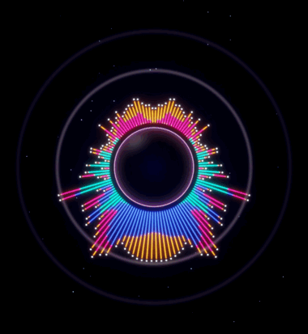

# Metal Audio Visualizer

Real-time, GPU-driven audio visualizer for iOS. It plays four isolated audio stems
in sync and draws their spectra as one glowing ring: 120 rays around a glass core,
where every ray is a frequency band and its colors show which instruments are
sounding at that pitch.

Built with **Swift**, **SwiftUI**, **Metal**, **Accelerate**, and **AVAudioEngine**.

<p align="center">
  
</p>

<p align="left">
  
  
  
  
</p>

---

## Overview

The app plays four pre-separated stems of a single track simultaneously and keeps them
sample-aligned. Each stem gets its own spectrum, and the four are stacked end to end
along the rays of the ring — low frequencies at the bottom, highs at the top, mirrored
left and right. Drum hits send shockwaves out of the core.

| Stem   | Role       | Color  |
| ------ | ---------- | ------ |
| 🎹 Other  | harmony    | teal   |
| 🎸 Bass   | low end    | blue   |
| 🎤 Vocals | melody     | pink   |
| 🥁 Drums  | transients | amber  |

## Features

- **Four independent stems** played in perfect sync via a single `AVAudioEngine` graph.
- **Per-stem spectrum analysis** — a 2048-point FFT (Accelerate/vDSP) folded into
  60 log-spaced bands per stem.
- **Playhead-accurate sync** — audio taps fire only about ten times a second, so each
  stem is analyzed ahead of playback and the renderer samples that timeline at the
  exact playback position, compensated for output latency.
- **Beat detection** — spectral flux on the drum stem triggers a shockwave on every hit.
- **Procedural scene** — rays, core, and dust are signed-distance shapes evaluated in a
  single fragment shader: no geometry, and anti-aliasing at any resolution.
- **HDR bloom pipeline** — the scene is rendered to `rgba16Float`, blurred through a
  6-level downsample/upsample chain, then ACES tone-mapped and dithered.
- **60 FPS** rendering through `MTKView`.

## Tech stack

| Layer         | Technology                          |
| ------------- | ----------------------------------- |
| UI            | SwiftUI (`UIViewRepresentable`)     |
| Audio         | AVAudioEngine, AVAudioPlayerNode    |
| Analysis      | Accelerate (vDSP)                   |
| Rendering     | Metal, MetalKit (`MTKView`)         |
| Shading       | Metal Shading Language              |
| Language      | Swift 5                             |

## Getting started

**Requirements:** Xcode 26.2+, iOS 26.2+ device or simulator.

```bash
git clone https://github.com/nevzorov46/MetalAudioVisualizer.git
cd MetalAudioVisualizer
open MetalAudioVisualizer.xcodeproj
```

Select an iOS Simulator (or a device) and press **Run** (⌘R). The four stems in
`MetalAudioVisualizer/Audio Tracks/` load automatically on launch.

To visualize your own track, split it into `vocals.m4a`, `drums.m4a`, `bass.m4a`, and
`other.m4a` (any stem separator works) and drop them into the `Audio Tracks` folder.

## Project structure

```
MetalAudioVisualizer/
├── MetalAudioVisualizerApp.swift   App entry point
├── ContentView.swift               Root SwiftUI view
├── MetalView.swift                 SwiftUI ↔ MTKView bridge
├── AudioAnalyzer.swift             Playback, spectrum timeline, playhead
├── SpectrumAnalyzer.swift          FFT → log-spaced bands (vDSP)
├── BeatDetector.swift              Drum-hit detection (spectral flux)
├── Renderer.swift                  Scene → bloom → composite passes
├── Scene.metal                     The visualizer itself (SDF fragment shader)
├── PostProcess.metal               Bloom chain and tone mapping
├── ShaderCommon.h                  Types shared by the shaders
├── Constants.swift                 Tunable parameters
└── Audio Tracks/                   Sample stems (.m4a)
```

## Roadmap

- [ ] Live microphone / system-audio input
- [ ] Selectable tracks from the Files app
- [ ] User-configurable color themes

## License

Released under the [MIT License](LICENSE).

## Author

**Valery Nevzorov** — [GitHub](https://github.com/nevzorov46)
